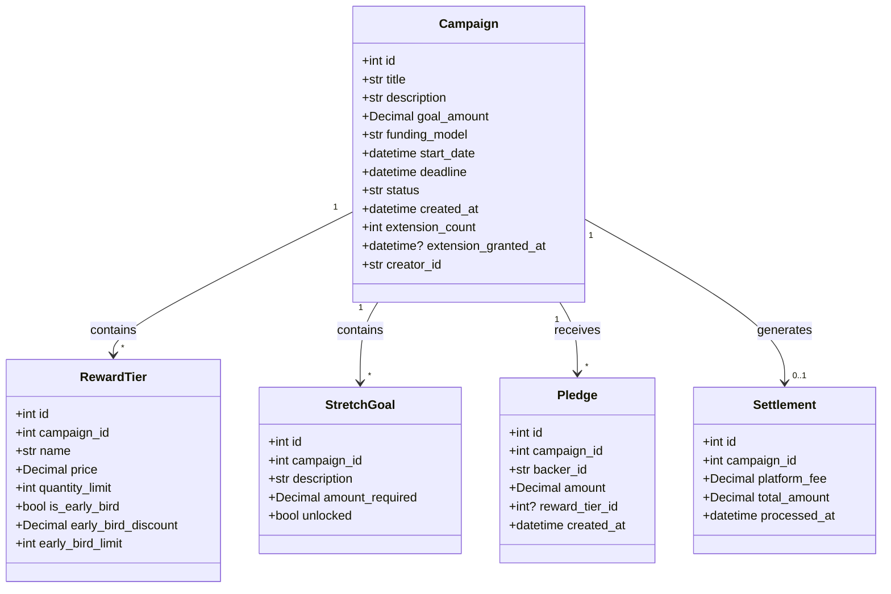
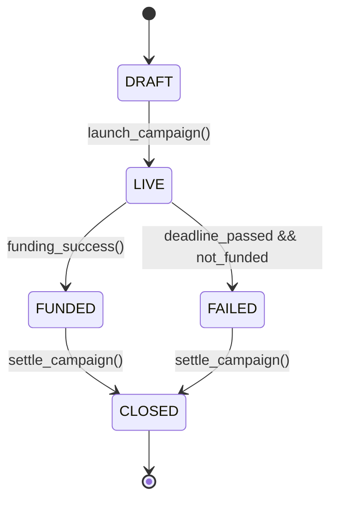

# Design Document

## Glossary

- **Campaign**: A fundraising effort identified by a title, description, goal amount, start/end dates, and status (`DRAFT`, `LIVE`, `FUNDED`, `FAILED`, `CLOSED`).
- **Pledge**: A contribution made by a backer to a campaign, optionally selecting a reward tier. Includes amount, backer identifier, and timestamps.
- **RewardTier**: A defined reward for a campaign with a price, quantity limit, early‑bird flag, discount, and early‑bird limit.
- **StretchGoal**: An additional target beyond the original goal that, when reached, unlocks extra rewards or features.
- **Settlement**: The final financial processing after a campaign ends, handling platform fees, refunds, and chargebacks.
- **CSV Ingestion Service**: Service that reads bulk reward‑tier or stretch‑goal data from CSV files and creates corresponding records.
- **Command‑File Processor**: Reads a plain‑text file of commands and invokes service methods to perform batch operations.

## Class Diagram

## State Diagram (Campaign Lifecycle)

## Business‑Rule Register (Implemented Rules)

| ID | Description | Location in Code |
|----|-------------|------------------|
| **BR‑01** | Campaign can transition from **DRAFT** to **LIVE** only if start date is in the future and goal amount > 0. | `app/services/campaign_service.py` (`launch_campaign` validation) |
| **BR‑02** | A campaign becomes **FUNDED** when total pledged amount ≥ goal amount before deadline. | `app/services/campaign_service.py` (`check_funding_status`) |
| **BR‑03** | If deadline passes without reaching goal, status becomes **FAILED**. | `app/services/campaign_service.py` (`handle_deadline`) |
| **BR‑04** | Backers may select a **RewardTier** only if quantity limit not exceeded. | `app/services/pledge_service.py` (`add_pledge`) |
| **BR‑05** | Early‑bird discount applies only within `early_bird_limit` pledges and when `is_early_bird` flag is true. | `app/services/pledge_service.py` (early‑bird logic) |
| **BR‑06** | Stretch goals unlock automatically when cumulative pledges reach `amount_required`. | `app/services/stretch_goal_service.py` (`evaluate_stretch_goals`) |
| **BR‑07** | Settlement calculates platform fee (e.g., 5 % of total) and records final amounts. | `app/services/settlement_service.py` (`process_settlement`) |
| **BR‑08** | Refunds are allowed only for campaigns that are **FAILED** or when a backer requests before settlement. | `app/services/refund_service.py` (`create_refund`) |
| **BR‑09** | Chargebacks reverse a pledge and adjust campaign totals accordingly. | `app/services/chargeback_service.py` (`process_chargeback`) |
| **BR‑10** | CSV ingestion validates that all required columns are present before creating records. | `app/services/csv_ingestion_service.py` (`validate_headers`) |
| **BR‑11** | Command‑file processor executes commands in the order they appear and stops on the first error. | `app/services/command_file_processor.py` (`process_file`) |

**Note:** The register lists only rules that have concrete implementation in the current code base. Any additional specification items not represented in the source are omitted.
